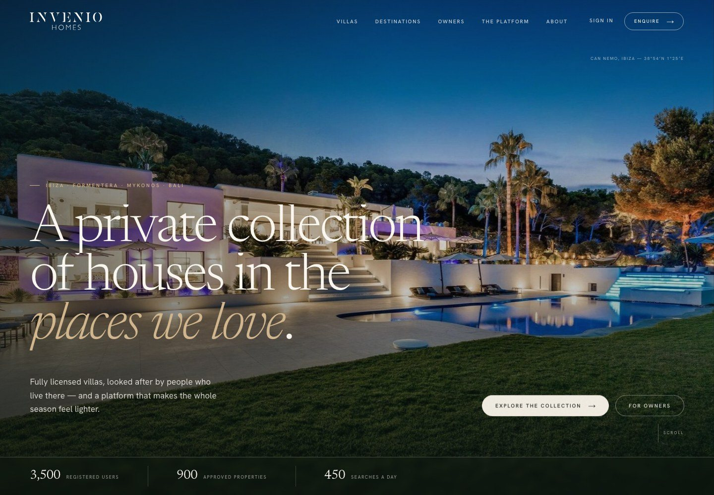
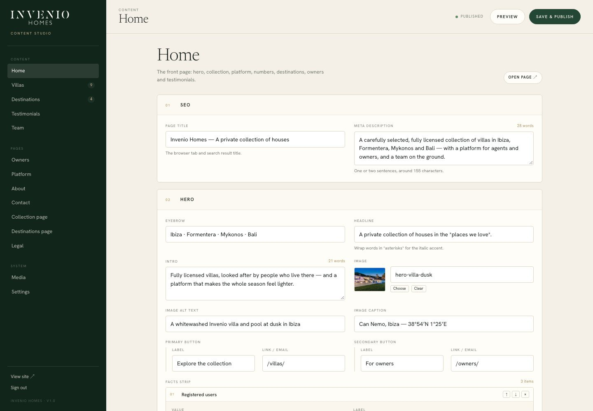
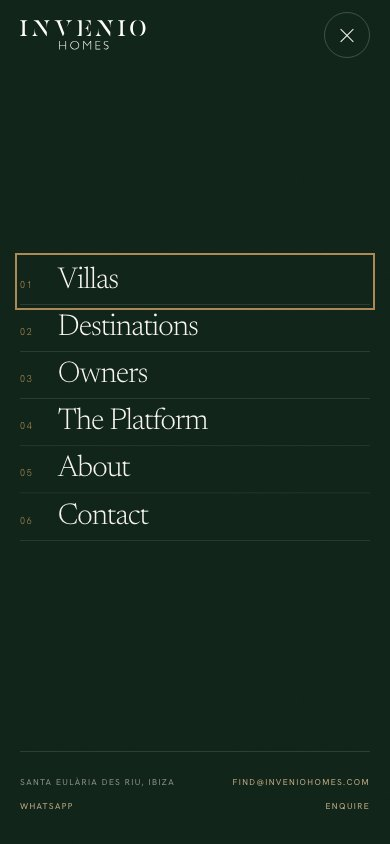
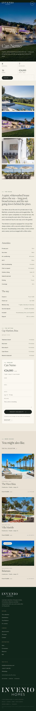

# Invenio Homes

**Live:** <https://deepseek-one-phi.vercel.app/>  
**GitHub:** <https://github.com/edoardo-hash/Deepseek>  
**Studio:** runs locally (see below)

A complete website for Invenio Homes, rebuilt as a **content-driven static site** with the cinematic scroll behaviour of the current site — and a small, purpose-built **Content Studio** instead of WordPress.

- **Public site:** 25 pages, fully responsive, server-rendered HTML.
- **Motion:** Lenis smooth scroll, GSAP split-line headings, image reveals and parallax, marquees, counters, a draggable testimonial slider, a full-screen menu, page transitions, a custom cursor and a first-load curtain.
- **Editing:** every word, image, house, island, testimonial and legal page lives in `content/`. The Studio writes those files and rebuilds the site in about a second.
- **No WordPress:** no database, no plugins, no PHP, no monthly updates. The output is a folder of static files that can be hosted anywhere.

## Screenshots

| Home | Content Studio |
|---|---|
|  |  |

| Mobile menu | House page |
|---|---|
|  |  |

More in [`screenshots/final`](screenshots/final).

---

## Start it

Requirements: **Python 3.10+** (Pillow for image uploads) and **Node 18+**. No `npm install` is needed.

```bash
cd invenio-homes

# build the static site into dist/
python3 build.py

# serve the site + Studio
node server.mjs
```

Then open:

- **Site** — <http://127.0.0.1:4173/>
- **Studio** — <http://127.0.0.1:4173/studio/>

On a fresh machine, `node server.mjs` will build the site automatically if `dist/` is missing. For a static preview only, `npm run preview` serves `dist/` on port 4321.

### Studio password

By default the Studio is **only bound to `127.0.0.1` and open** — convenient for a local editor. Before exposing it, set a password and bind it to your network:

```bash
STUDIO_PASSWORD='a-long-random-password' \
HOST=0.0.0.0 \
PORT=8080 \
SECURE_COOKIE=1 \
node server.mjs
```

The server refuses to start on a non-loopback host without `STUDIO_PASSWORD`. Put it behind HTTPS (Caddy, nginx, a PaaS) and use `SECURE_COOKIE=1`. The login sets an HttpOnly, SameSite=Strict, HMAC-signed cookie; the API also checks the request origin.

---

## Editing in the Studio

The Studio is a single-page editor with a live preview, image library and one-click publish. It is designed around the way this site is actually made:

| Section | What it edits |
|---|---|
| **Home** | Hero, introduction, marquee, featured houses, platform, numbers, destinations, owners, testimonials, closing CTA |
| **Villas** | Add, reorder and delete houses; every fact, paragraph, photograph, amenity and distance |
| **Destinations** | The four island pages, their stories, highlights, seasons and galleries |
| **Testimonials** | The quotes shown on the home page |
| **Team** | The people and groups on About |
| **Pages** | Owners, Platform, About, Contact, Collection, Destinations, Legal |
| **Media** | Upload and reuse images; copy their content path |
| **Settings** | Brand, contact details, navigation, footer, social links, SEO defaults, form endpoint |

**Save & publish** writes the JSON, rebuilds the site, and reloads the preview. `⌘S` / `Ctrl+S` works. Every save keeps a timestamped copy of the previous file in `.studio/backups/`.

### Images

Upload a JPEG, PNG or WebP (up to 14 MB). The Studio strips metadata and generates 480, 960, 1600 and 2400 px versions in `assets/img/uploads/`, then stores only the base name in the content. The site uses responsive `srcset` for them.

### Adding a house or an island

Use **Villas → Add villa** or **Destinations → Add destination**. A new page is generated on the next save at `/villas/<slug>/` or `/destinations/<slug>/`. Changing a slug changes that URL; update any links to it (the Studio warns about duplicate slugs, not about old links).

### What the Studio does not do

It is not a page builder. The layout is fixed by the design system; the content is editable. Adding a brand-new *type* of section is a code change in `build.py` (and, for the editor, `studio/schema.js`). That constraint is deliberate: it is what keeps the site coherent and the editing surface small.

---

## Project structure

```text
invenio-homes/
├── content/                  ← the editable site (plain JSON)
│   ├── settings.json         brand, nav, footer, contact, SEO
│   ├── home.json             the front page
│   ├── villas.json           9 houses (sample data — see below)
│   ├── destinations.json     4 islands
│   ├── testimonials.json
│   ├── team.json
│   └── pages/                owners, platform, about, contact, collection,
│                             destinations, legal
├── assets/
│   ├── css/site.css          the design system + responsive rules
│   ├── js/site.js            motion + interactions
│   ├── js/vendor/            GSAP, ScrollTrigger, SplitText, Lenis
│   ├── fonts/                self-hosted Cormorant Garamond + Inter
│   └── img/                  photography, grain, logos, uploads/
├── studio/
│   ├── index.html            editor shell
│   ├── studio.css            editor design
│   ├── app.js                editor logic
│   └── schema.js             every editable field
├── build.py                  dependency-free static generator
├── server.mjs                site + Studio server (Node, no dependencies)
├── tools/prepare_image.py    upload resizing
├── dist/                     generated site — deploy this folder
├── netlify.toml
├── Dockerfile
└── screenshots/              desktop + mobile reference captures
```

The build reads `content/` and writes `dist/`. It also copies `assets/` into `dist/assets/`, generates `sitemap.xml`, `robots.txt`, the favicon and a 404 page.

---

## The pages

| Route | Page |
|---|---|
| `/` | Home |
| `/villas/` | The collection, with island filters |
| `/villas/<house>/` | House detail, gallery, amenities, distances, enquiry |
| `/destinations/` | Four islands, editorial index |
| `/destinations/<island>/` | Island story, highlights, gallery, houses, season |
| `/owners/` | Owner proposition, service, process, FAQ |
| `/platform/` | The platform, dashboard mock, features, agent and owner access |
| `/about/` | Story, values, numbers, team, offices |
| `/contact/` | Contact details and enquiry form |
| `/legal/privacy/`, `/cookies/`, `/terms/` | Legal |
| `/credits/` | Photography, type and code credits |
| `/404.html` | Not found |

---

## Design & motion notes

**Ses Salines.** Bone paper `#F2EDE3`, ink `#1C221D`, seagrass `#244635`, salt gold `#B08A55`; Cormorant Garamond Light for display and Inter for text. Square photography, hairline rules, numbered catalogue rows, a seagrass numbers band and a private-offer register.

The motion follows the current site's grammar rather than copying its markup:

- the hero image is revealed by a clip mask and settles from a slow scale;
- headings are split into masked lines and lifted into place;
- images reveal and then drift at a different speed to the page;
- two marquee rows run in opposite directions;
- the numbers count up only when they enter the viewport;
- collection rows float a large image beside the cursor (desktop);
- the testimonial rail can be dragged, clicked and driven with the keyboard;
- the menu wipes down over the page and staggers its links;
- internal navigation wipes the next page in through the same curtain as the loader;
- `prefers-reduced-motion` removes all of it, and the site is fully readable with JavaScript disabled.

The type is self-hosted, so there is no Google Fonts request. The grain texture is generated. All JavaScript libraries are vendored locally.

---

## Deployment

### A. Static site (Vercel — currently live)

The site is already connected:

- **GitHub:** <https://github.com/edoardo-hash/Deepseek>
- **Vercel:** <https://deepseek-one-phi.vercel.app/> (project `deepseek`, production branch `main`)
- The Vercel project is set to **Other**, with the build command skipped and **Output Directory = `dist`**. The `dist/` folder is committed, so every push to `main` deploys exactly what the Studio built.
- The public URL is assigned by Vercel when the project is first deployed.

Typical publishing loop:

```bash
# edit in the Studio, then:
python3 build.py
git add -A
git commit -m "Update site content"
git push
# Vercel deploys main automatically
```

The live deployment uses **Settings → Site URL** (`site.url` in `content/settings.json`), so canonical URLs, Open Graph images and `sitemap.xml` are correct. When `inveniohomes.com` is attached to Vercel, change that field to `https://inveniohomes.com` and publish. The `SITE_URL` environment variable overrides it for one-off builds.

```bash
SITE_URL=https://inveniohomes.com python3 build.py
```

`vercel.json` and `netlify.toml` are both included. The site is only static files, so it also deploys to Cloudflare Pages, S3 or any static host.

### B. Site + Studio on a Node host (a small VPS is ideal)

Run `node server.mjs` with a password and a persistent disk. The edits, uploads and backups live in:

- `content/`
- `assets/img/uploads/`
- `.studio/`

The host needs Python 3 and Pillow because publishing runs `build.py`. The included `Dockerfile` installs both:

```bash
docker build -t invenio-homes .
docker run -d -p 8080:8080 \
  -e STUDIO_PASSWORD='a-long-random-password' \
  -e SECURE_COOKIE=1 \
  -v "$PWD/content:/app/content" \
  -v "$PWD/assets/img/uploads:/app/assets/img/uploads" \
  -v "$PWD/.studio:/app/.studio" \
  invenio-homes
```

Put it behind HTTPS. Do **not** deploy `studio/` to a static host on its own — it needs the API and filesystem.

### Forms

`content/settings.json → site.formEndpoint` is empty by default, which means the contact and villa forms open the visitor's email app with the message pre-filled. Paste a Formspree/Basin/Formspark endpoint there to post instead. The endpoint receives a normal `multipart/form-data` POST.

### Analytics & cookies

No analytics are installed. The privacy and cookie pages describe the policy if analytics are added later. If you add a non-essential script, add a consent gate — the site deliberately ships without a cookie banner.

---

## What is real, and what is sample content

This is a production-shaped build, not a data migration. Before launch:

- **Replace the sample houses and rates.** `villas.json` has 9 houses. Six are Ibiza houses from the existing portfolio; Can Talaia, Aegean House and Villa Sawah are sample entries for Formentera, Mykonos and Bali. Rates, distances, amenities and some licences are illustrative. Verify every licence number.
- **Replace representative photography.** The Mykonos image is a CC BY-SA photograph (credited on `/credits/`); Bali is an Unsplash photograph. The client archive is used for the Ibiza houses. Swap in final, licensed photography and update credits.
- **Confirm the figures.** 3,500 users / 900 properties / 450 searches a day come from the current site and are marked “2026 season”. The live site itself says the figures should be verified.
- **Set the portal URL.** `site.portalUrl` and `site.signinUrl` currently point to `/platform/#access`. Replace them with the real portal sign-in URL.
- **Set the form endpoint** if the client wants form submissions by email rather than `mailto:`.
- **Review the legal pages with counsel.** They are written as a reasonable starting point, not as legal advice.
- **Add team headshots** if desired. The design uses initials deliberately; the current pack has no licensed portraits.
- **Translations.** This build is English-only. The content model and templates are ready for a second locale, but adding one is a code change: duplicate `content/` into `content/es/`, add a language switch and a build loop.

---

## Development notes

```bash
python3 build.py              # rebuild dist/
node server.mjs               # site + studio on :4173
npm run preview               # static only on :4321
```

- The build is deliberately dependency-free; `build.py` uses only the standard library (Pillow is optional, for the touch icon).
- `server.mjs` has no npm dependencies either.
- The Studio writes only to an allow-listed set of files (`DOC_FILES` in `server.mjs`).
- Uploads are validated by file signature, not just extension, and resized by `tools/prepare_image.py`.
- The JSON is human-readable and version-controllable. A good workflow is to commit `content/` and `assets/img/uploads/` alongside the site.

### Testing the site

The `screenshots/` folder contains desktop and mobile captures used during QA, including the Studio. Before launch, check:

- every internal link and image resolves;
- the site at 1440, 1024, 760 and 390 px;
- `prefers-reduced-motion: reduce` shows the complete page with no hidden sections;
- JavaScript disabled still shows all content;
- the contact form either opens a prefilled email or posts to the endpoint;
- `SITE_URL` is set and `canonical` / `og:url` / `sitemap.xml` point at the production domain.

---

## Credits

See [`/credits/`](dist/credits/index.html) in the running site, or `CREDITS.md`.

- Photography: Invenio archive and handoff pack; Mykonos by René Hourdry (CC BY-SA 4.0); Bali via Unsplash.
- Type: Cormorant Garamond and Inter, SIL Open Font License.
- Motion: GSAP (ScrollTrigger, SplitText) and Lenis (MIT).
- Design and build: Ses Salines direction, 2026.

---

*Built without WordPress. Content is JSON, the output is HTML, and the whole thing fits in a folder.*
